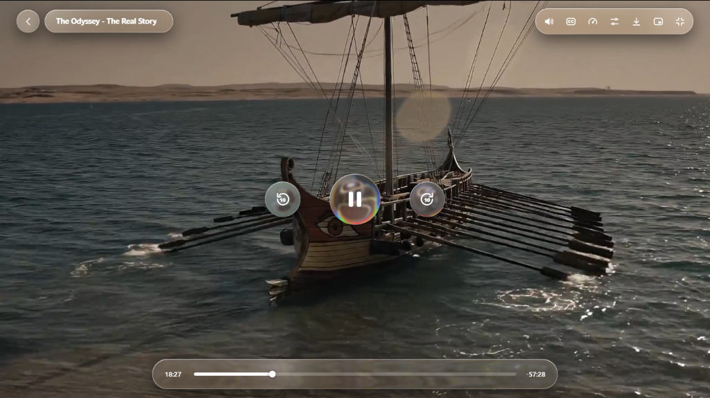
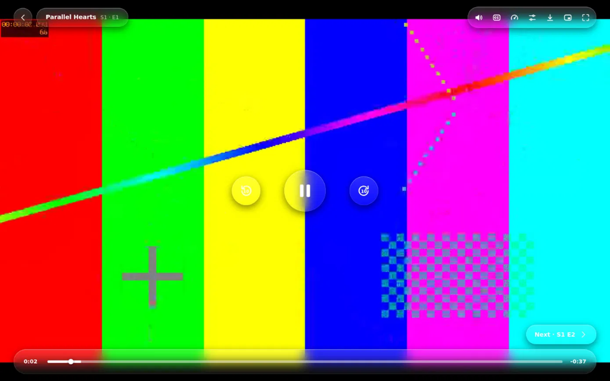
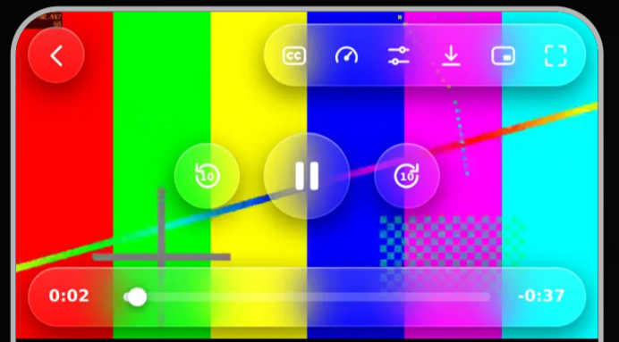
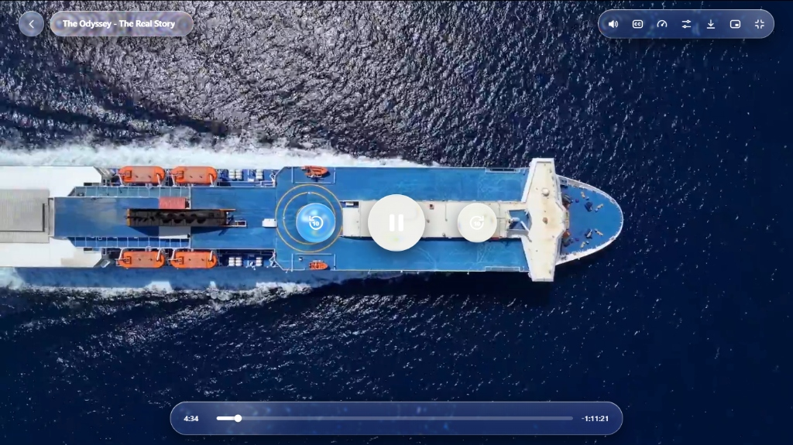
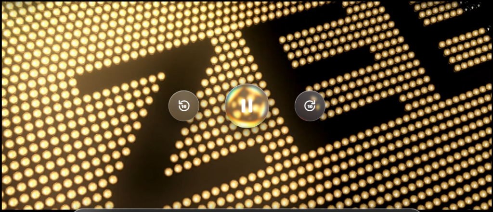

# LiQu Player (LiQuPlayer.js)

> **The Powerhouse Open-Source Video Player Inspired by Apple-Style Liquid Glass UI.**

[](LICENSE)
[](package.json)
[](https://github.com/ImAhmedZarir/LiQuPlayer.js/pulls)
[](#features)
[-purple.svg)](#low-ram--hardware-optimization)

**LiQu Player** is a next-generation open-source media player featuring authentic optical rim refraction, spherical fluid orbs, dynamic pointer-tracked glare hotspots, and spring-damper jelly physics. Built with a universal streaming engine, it seamlessly plays **Direct Video (MP4/WebM/OGG)**, **HLS (.m3u8)**, **MPEG-DASH (.mpd)**, **YouTube**, and **Vimeo** behind an identical, ultra-premium liquid glass interface.

---

## Showcase & UI Previews

<div align="center">
  
</div>

<br/>

| Desktop Cinema Interface | Compact Mobile View (Image 2) |
|:---:|:---:|
|  |  |

| Spherical Liquid Lens Distortion | LED Ambient Pulse Refraction |
|:---:|:---:|
|  |  |

---

## Features

- **True Optical Rim Refraction**: Uses custom SVG displacement maps and channel differences to genuinely bend and refract the video playing underneath.
- **Spherical Droplet Lens**: Center play button acts as a real fluid marble, magnifying and distorting the underlying image with chromatic aberration.
- **Universal Format Engine**:
  - Direct HTML5 video (`.mp4`, `.webm`, `.ogv`, `.mov`)
  - HLS Adaptive Bitrate Streaming (`.m3u8`) with auto-loaded lightweight Hls.js
  - MPEG-DASH Streaming (`.mpd`) with auto-loaded Dash.js
  - YouTube URL integration (`youtube.com/watch`, `youtu.be`, embed) synced transparently under liquid glass controls
  - Vimeo URL integration
  - Offline Procedural SMPTE Color Bar Generator (`test:colorbar`)
- **Ultra-Low RAM & Old Device Optimization**:
  - **Ultra Fluid Mode**: Real SVG refraction filter + chromatic fringe + cursor specular tracking.
  - **Balanced Mode (60 FPS)**: Hardware-accelerated CSS frosted glass (`blur(16px) saturate(1.8)`), solid 60 FPS on mobile.
  - **Lite Mode**: Hardware-optimized lightweight glass (`blur(8px)` + dark tint) designed for low-end Android devices and older smart TVs.
  - Total JS heap memory consumption is under **15 MB**.
- **Touch & Gesture Engine**:
  - Double-tap left/right to seek -10s / +10s with ripple wave feedback.
  - Vertical swipe on left side: Brightness HUD adjust.
  - Vertical swipe on right side: Volume HUD adjust.
  - Droplet surface ripple on click/tap.
- **System MediaSession Integration**:
  - Full synchronization with iOS/Android lock screens, Windows Volume HUD, and macOS Now Playing menu.
- **Dynamic Cinema Ambient Glow**:
  - Real-time video canvas sampling projects a reactive ambient light field around the player.
- **Cross-Platform Ready**:
  - Web browsers (Chrome, Edge, Safari, Firefox, Opera, Brave).
  - Desktop applications (Electron, Tauri, NW.js).
  - Mobile hybrid apps (Capacitor, Cordova, React Native WebView, Flutter WebView).
  - PWA / Mobile Web.

---

## Quick Start

### 1. Include CSS & JS

```html
<!-- LiQu Player Stylesheet -->
<link rel="stylesheet" href="LiQuPlayer.css">

<!-- LiQu Player Standalone Library -->
<script src="LiQuPlayer.js"></script>
```

### 2. Add Container Element

```html
<div id="player" style="max-width: 960px; margin: 0 auto;"></div>
```

### 3. Initialize

```html
<script>
  const player = new LiQuPlayer('#player', {
    source: 'https://commondatastorage.googleapis.com/gtv-videos-bucket/sample/ForBiggerBlazes.mp4',
    title: 'The Odyssey - The Real Story',
    subtitle: 'S1 · E1',
    poster: 'assets/images/preview-odyssey-ship.png',
    glassMode: 'ultra', // 'ultra' | 'balanced' | 'lite'
    ambientGlow: true,
    nextEpisode: {
      title: 'Next · S1 E2',
      onClick: () => console.log('Playing Next Episode...')
    }
  });
</script>
```

---

## Configuration Options

| Option | Type | Default | Description |
|---|---|---|---|
| `source` | `string` \| `object` | `null` | Video URL, HLS `.m3u8`, DASH `.mpd`, YouTube link, or `'test:colorbar'` |
| `title` | `string` | `'LiQu Player'` | Title displayed in the liquid glass header badge |
| `subtitle` | `string` | `''` | Subtitle/episode info (e.g. `'S1 · E1'`) |
| `poster` | `string` | `''` | Thumbnail poster image URL |
| `autoplay` | `boolean` | `false` | Whether video starts playing automatically |
| `muted` | `boolean` | `false` | Start playback muted |
| `volume` | `number` | `1` | Initial volume between `0` and `1` |
| `glassMode` | `'ultra'` \| `'balanced'` \| `'lite'` | `'ultra'` | Liquid glass rendering complexity |
| `ambientGlow` | `boolean` | `true` | Real-time reactive ambient lighting |
| `downloadable` | `boolean` | `true` | Show download action in top dock |
| `nextEpisode` | `object` | `null` | Config `{ title: 'Next · S1 E2', onClick: fn }` |

---

## Public API Methods

```javascript
// Playback Controls
player.play();
player.pause();
player.togglePlay();
player.seekTo(120);          // Jump to 2 minutes (120s)
player.seekBy(-10);          // Rewind 10 seconds
player.seekBy(10);           // Skip forward 10 seconds

// Volume & Speed
player.setVolume(0.8);       // 0.0 to 1.0
player.toggleMute();
player.setPlaybackRate(1.5); // 0.25x to 2.0x

// Source & Metadata
player.setSource('https://example.com/another.mp4', {
  title: 'Parallel Hearts',
  subtitle: 'S1 · E2'
});

// Fullscreen & PiP
player.toggleFullscreen();
player.togglePiP();

// Liquid Glass Tuning
player.liquidEngine.setMode('balanced'); // Switch between 'ultra', 'balanced', 'lite'
player.toggleAmbientGlow();

// Cleanup
player.destroy();
```

---

## Keyboard Shortcuts

| Key | Action |
|---|---|
| `Space` or `k` | Toggle Play / Pause |
| `Left Arrow` or `j` | Seek Backward 10 Seconds |
| `Right Arrow` or `l` | Seek Forward 10 Seconds |
| `Up Arrow` | Increase Volume (+5%) |
| `Down Arrow` | Decrease Volume (-5%) |
| `m` | Toggle Mute |
| `f` | Toggle Fullscreen |
| `p` | Toggle Picture-in-Picture |
| `0` - `9` | Seek to 0% - 90% of duration |

---

## Mobile Gestures

- **Double-Tap Left**: Seek -10s with liquid ripple.
- **Double-Tap Right**: Seek +10s with liquid ripple.
- **Vertical Swipe (Left Screen)**: Adjust Brightness.
- **Vertical Swipe (Right Screen)**: Adjust Volume.
- **Single Tap**: Reveal / Toggle Controls.
- **Auto-Hide**: Controls vanish smoothly after 2.8 seconds of inactivity.

---

## Supported Streaming Formats

| Format | Extensions / Protocols | Engine |
|---|---|---|
| **Direct HTML5** | `.mp4`, `.webm`, `.ogv`, `.mov`, `blob:` | Native HTML5 Video Element |
| **HLS** | `.m3u8`, Apple HLS Live / VOD | Native WebKit HLS or Auto-CDN Hls.js |
| **MPEG-DASH** | `.mpd`, DASH Manifests | Auto-CDN Dash.js |
| **YouTube** | URLs, Video IDs, Shorts | YouTube IFrame API Adapter |
| **Vimeo** | `vimeo.com/*` | Vimeo Player SDK Adapter |
| **Offline Test** | `test:colorbar`, `test:pattern` | Procedural Animated Canvas Engine |

---

## How Liquid Refraction Works

1. **Displacement Mapping**: A canvas buffer renders an $(x, y)$ displacement map where Red encodes horizontal refraction and Blue encodes vertical refraction. An inset rounded rect or sphere filled with neutral 50% gray restricts bending precisely to the outer perimeter rim.
2. **Chromatic Aberration**: The displacement map is evaluated across three channels at staggered optical strengths, recombined through SVG `feColorMatrix` and `feBlend mode="screen"`.
3. **Hardware Acceleration**: The filter evaluates exclusively on the GPU via `backdrop-filter: url(#id)`. Map generation is debounced and cached, maintaining a microscopic memory footprint.
4. **Fallback Matrix**: Safari and Firefox gracefully receive an Apple-tuned frosted blur fallback (`blur(16px) saturate(1.8)`), guaranteeing full visual consistency across all browsers.

---

## License

LiQu Player is open-source software licensed under the [MIT License](LICENSE).
Created by [Ahmed Zarir](https://github.com/ImAhmedZarir).
